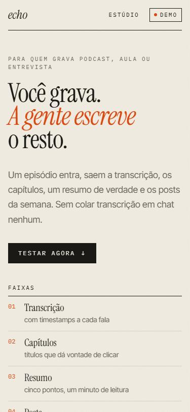
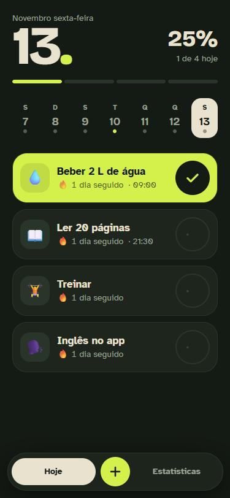
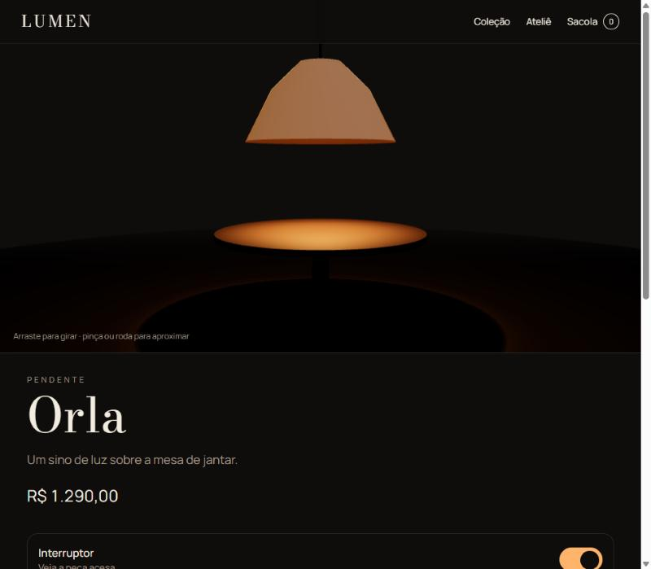
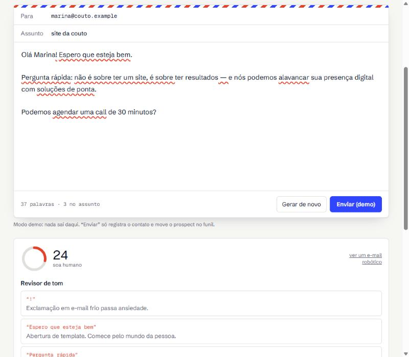
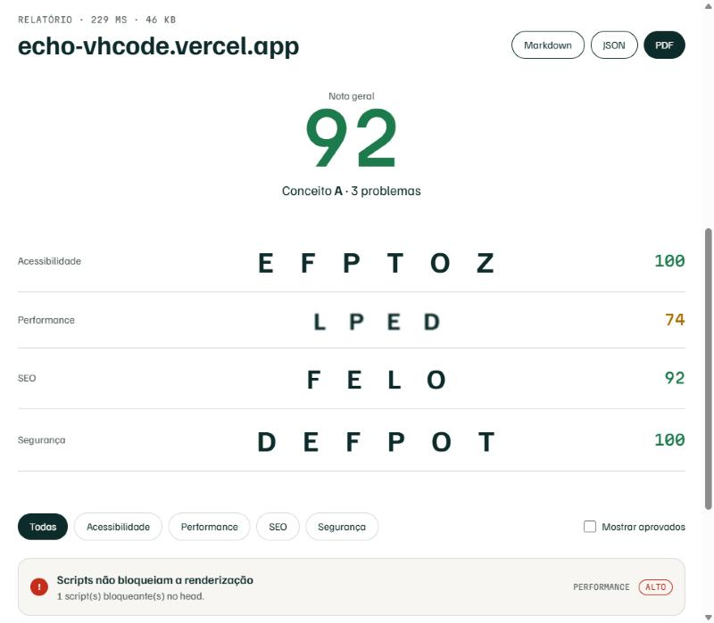
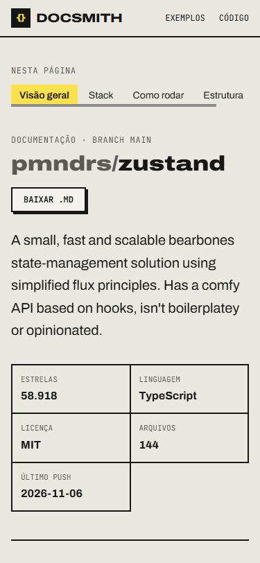
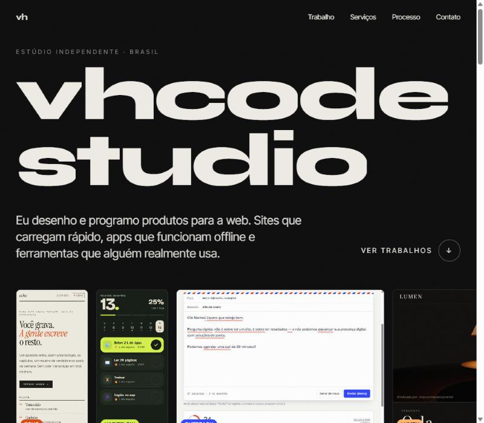

  

   

  
  

## Sobre mim

Sou **Victhor Hugo** e toco a **vhcodestudio**, um estúdio independente de produto digital. Desenho e programo sites, apps e ferramentas web do primeiro rascunho ao deploy: arquitetura, interface, testes, segurança e publicação.

Trabalho principalmente com Next.js, React, React Native, Expo, TypeScript, Tailwind CSS e Supabase. Todos os projetos abaixo estão no ar e têm README em português e inglês.

## Projetos novos

<table>
  <tr>
    <td width="50%" valign="top">
      
      <h3><a href="https://echo-vhcode.vercel.app">echo</a></h3>
      Um episódio de podcast entra e saem transcrição com timestamps, capítulos, resumo e posts para LinkedIn, X e Instagram. A forma de onda vira o navegador de capítulos.
       Next.js 16 · React 19 · Motion · Vitest
       <a href="https://echo-vhcode.vercel.app">Abrir</a> · <a href="https://github.com/vhcodestudio/echo">Código</a>
    </td>
    <td width="50%" valign="top">
      
      <h3><a href="https://habitflow-vhcode.vercel.app">habitflow</a></h3>
      App de hábitos instalável que funciona sem internet. Marcar um hábito preenche o card, a sequência rola como odômetro e as estatísticas mostram seu melhor dia da semana. Testado num Pixel 10.
       Vite · React 19 · PWA · Motion · Vitest
       <a href="https://habitflow-vhcode.vercel.app">Abrir</a> · <a href="https://github.com/vhcodestudio/habitflow">Código</a>
    </td>
  </tr>
  <tr>
    <td width="50%" valign="top">
      
      <h3><a href="https://lumen-store-vhcode.vercel.app">Lumen</a></h3>
      Loja de luminárias de uma marca fictícia. Cada peça aparece em 3D, acesa, com temperatura de cor ajustável. Checkout com Stripe em modo de teste e preços conferidos no servidor.
       Next.js 16 · React Three Fiber · Stripe · Motion
       <a href="https://lumen-store-vhcode.vercel.app">Abrir</a> · <a href="https://github.com/vhcodestudio/lumen-store">Código</a>
    </td>
    <td width="50%" valign="top">
      
      <h3><a href="https://outreach-vhcode.vercel.app">outreach</a></h3>
      CRM de prospecção para freelancers. Funil de arrastar, sequências de follow-up que param quando a pessoa responde e um revisor que sublinha o que soa como template no e-mail.
       Next.js 16 · TypeScript · Motion · Vitest
       <a href="https://outreach-vhcode.vercel.app">Abrir</a> · <a href="https://github.com/vhcodestudio/outreach">Código</a>
    </td>
  </tr>
  <tr>
    <td width="50%" valign="top">
      
      <h3><a href="https://a11y-lens-vhcode.vercel.app">a11y-lens</a></h3>
      Cole uma URL e receba notas de acessibilidade, performance, SEO e segurança, com explicação e correção para cada problema. Exporta em Markdown, JSON ou PDF.
       Next.js 16 · node-html-parser · Motion · Vitest
       <a href="https://a11y-lens-vhcode.vercel.app">Abrir</a> · <a href="https://github.com/vhcodestudio/a11y-lens">Código</a>
    </td>
    <td width="50%" valign="top">
      
      <h3><a href="https://docsmith-vhcode.vercel.app">docsmith</a></h3>
      Cole a URL de um repositório público e receba um site de documentação com visão geral, estrutura, comandos e API. Cada repo ganha um link próprio.
       Next.js 16 · Cache Components · GitHub API · Vitest
       <a href="https://docsmith-vhcode.vercel.app">Abrir</a> · <a href="https://github.com/vhcodestudio/docsmith">Código</a>
    </td>
  </tr>
</table>

### [vhcodestudio.vercel.app](https://vhcodestudio.vercel.app)

O site do estúdio, com os estudos de caso de todos os projetos, serviços e processo.

Next.js 16 · Motion · [Código](https://github.com/vhcodestudio/vhcodestudio-site)

## Projetos anteriores, redesenhados

| Projeto | O que é | Links |
|---|---|---|
| **Orbit** | Workspace de operações com Kanban, roadmap e issues, navegável pelo teclado | [Demo](https://orbit-project-ops.vercel.app) · [Código](https://github.com/vhcodestudio/Orbit) |
| **Astraea AI** | Workspace de IA com conversas persistentes, projetos e autenticação em Supabase | [Demo](https://astraea-ai-ten.vercel.app) · [Código](https://github.com/vhcodestudio/astraea-ai) |
| **Nexus** | Dashboard SaaS multi-workspace de receita e clientes, com RLS no Supabase | [Demo](https://nexus-saas-dashboard-tawny.vercel.app/demo/dashboard) · [Código](https://github.com/vhcodestudio/nexus-saas-dashboard) |
| **Vitrine** | App Android de catálogo e pedidos para pequenos negócios, offline | [Versão web](https://vitrine-vhcode.vercel.app) · [APK demo](https://github.com/vhcodestudio/vitrine/releases/download/v1.0.0/vitrine-demo.apk) · [Código](https://github.com/vhcodestudio/vitrine) |

## Tecnologias

  

   
  Tem um projeto parado na gaveta? Escreva para <a href="mailto:vhcodestudio@gmail.com">vhcodestudio@gmail.com</a>.

